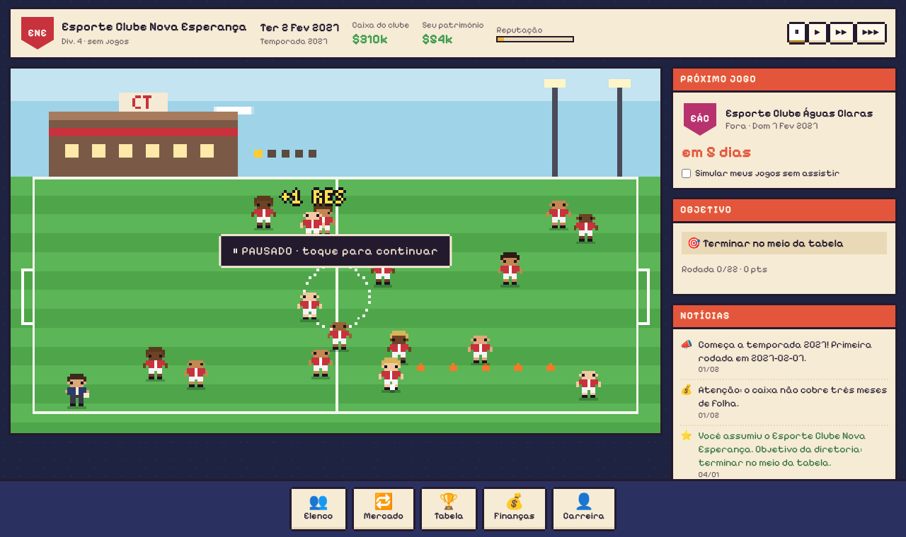

# Mestres do Esporte

> **Construa seu legado.**



Mestres do Esporte é um jogo de **gerenciamento e empreendedorismo esportivo**. Você não é só o técnico: é um empreendedor que constrói uma carreira. Começa administrando a organização de outra pessoa, ganha reputação, recebe propostas e, com o tempo, poderá virar sócio, comprar clubes e montar um grupo esportivo, em várias modalidades.

*"Comecei sem ninguém me conhecer. Construí minha reputação, enfrentei desafios, conquistei resultados e me tornei uma referência no esporte."*

---

## O conceito

| | |
|---|---|
| **Categoria** | Sports management / career simulation |
| **Filosofia** | A simplicidade dos managers clássicos, com profundidade de simulação e liberdade para criar histórias próprias |
| **Papel do jogador** | Empreendedor esportivo: contratado, sócio ou proprietário |
| **Plataforma** | Navegador (desktop e celular), single-player primeiro e online depois |
| **Modalidades** | Futebol (agora), automobilismo, basquete, vôlei, tênis e MMA (próximas fases) |

### Pilares

1. **Fácil de começar, difícil de largar.** Dá para entender o jogo em poucos minutos. A profundidade vem de atributos, probabilidades, economia e IA, que ficam por trás de ações simples.
2. **Você é o protagonista, não o centro do universo.** Clubes rivais contratam, evoluem, fracassam e conquistam títulos por conta própria.
3. **Carreira aberta.** Não existe campanha linear nem fim obrigatório. Atletas envelhecem, se aposentam e são substituídos, e a sua trajetória fica registrada.
4. **Decisões com consequência.** Escalação, mercado, preço do ingresso e postura no jogo mudam resultados, finanças e reputação.
5. **Memória.** Temporadas, campeões, artilheiros e a sua trajetória ficam guardados.

### Inspiração de ritmo: Game Dev Story

A referência de **ritmo e sensação** é a Game Dev Story (Kairosoft), que no fundo também é um simulador de empreendedorismo:

- **O tempo corre sozinho**, dia a dia, com pausa e 3 velocidades. O jogo para sozinho quando você precisa decidir (dia de jogo, fim de temporada, propostas).
- **Feedback constante e visual**: os atletas treinam no CT e os ganhos aparecem flutuando (`+1 FIN`, `+1 PAS`).
- **Crescimento por estrutura**: o nível do CT acelera a evolução, e investir em estrutura é investir em resultado.
- **Fechamento de ciclo**: premiação, balanço e novos objetivos a cada temporada.

A inspiração é de gênero e de ritmo. Toda a arte é **pixel art própria, gerada em código**, sem sprites, interface ou visual da Kairosoft. O mundo é **100% fictício**: clubes, atletas e cidades são gerados proceduralmente.

### O ciclo da carreira

```
Escolha do desafio → Gestão (elenco, mercado, finanças) → Partidas narradas
        ↑                                                         ↓
  Novas propostas ← Balanço e objetivos ← Classificação e premiação
```

---

## O que já dá para jogar (Fase 1: futebol)

- **Criação de carreira**: seu nome, a modalidade e um de três desafios (*Começar de baixo*, *Buscar crescimento*, *Administrar a pressão*), com oportunidades reais de clubes. Cada oportunidade mostra orçamento, reputação, estrutura e o objetivo da diretoria.
- **Tempo correndo** no CT em pixel art: treino diário, recuperação física, finanças mensais e notícias.
- **Atletas com 11 atributos** (físicos, técnicos e mentais), potencial, condição física e estatísticas da temporada.
- **Dia de jogo narrado**: pré-jogo, narração lance a lance, estatísticas ao vivo (posse, finalizações, escanteios, faltas), condição física e intervenções (postura, formação, substituições). Depois vem o pós-jogo com destaque da partida e notas. Para quem quer só avançar, existe a opção de simular sem assistir.
- **Mundo vivo**: 4 divisões com 12 clubes cada, acesso e rebaixamento, premiação, galeria de campeões, artilharia, aposentadorias e juniores.
- **Empreendedor separado da organização**: o seu patrimônio pessoal é separado do caixa do clube. Você recebe salário e bônus, a reputação muda conforme os objetivos, e você pode ser demitido ou receber propostas.
- **Economia**: bilheteria com preço elástico, cotas de TV, folha salarial, premiações, compra e venda de atletas, estados financeiros (estável, atenção, crítica).

## Rodar localmente

```bash
npm install
npm run dev        # http://localhost:5173
npm test           # 22 testes: liga, carreira, determinismo e balanceamento
npm run build
```

Atalho: **espaço** pausa ou retoma o tempo.

## Arquitetura em uma olhada

```
src/
  core/               genérico, não sabe qual é o esporte
    rng.ts            RNG determinístico com seed (base do online)
    calendar.ts       datas, fases da temporada
    entrepreneur.ts   empreendedor, vínculos, patrimônio, objetivos
    league.ts         turno/returno, tabela
    season.ts         temporada, divisões, acesso/rebaixamento
    sport.ts          contrato que cada modalidade implementa
  sports/football/    plugin do futebol: atributos, motor, narração, evolução
  game/career.ts      carreira: dia a dia, rodadas, finanças, mercado, propostas
  ui/                 React + canvas (CT em pixel art), save no navegador
docs/DESIGN.md        decisões de design, balanceamento, roadmap
```

**Duas decisões que importam:**
- **Simulação determinística.** Mesma seed + mesmas decisões = mesmo resultado. Assistir ao jogo ao vivo ou simular dá o mesmo placar (está coberto por teste). No online, o servidor será a autoridade e o cliente só reproduz o jogo.
- **Core agnóstico de esporte.** Temporada, finanças, carreira e mercado servem para todas as modalidades. Cada esporte novo é um plugin em `src/sports/`.

## Roadmap

| Fase | Objetivo | Escopo |
|---|---|---|
| **1. Fundação** *(em andamento)* | Provar que o ciclo central é divertido | Futebol single-player no navegador |
| 2. Universo online | Carreiras compartilhadas | Contas, ligas privadas, rodadas agendadas, servidor autoritativo |
| 3. Automobilismo | Testar a arquitetura com uma dinâmica diferente | Motor de corrida, pilotos, carros e engenharia |
| 4. Expansão | Mais modalidades | Basquete, vôlei, tênis e MMA, por interesse dos jogadores |

Detalhes, métricas de balanceamento e backlog estão em [docs/DESIGN.md](docs/DESIGN.md).

---

<sub>"Mestres do Esporte" é o nome do produto (o repositório se chama Elifoot2027 por histórico; o GDD original usava o nome de trabalho "Universo Esportivo"). Antes de um lançamento público, verificar marca no INPI.</sub>
